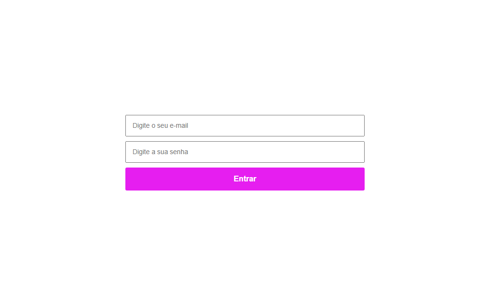

## 📝 Formulário com Validação

Um projeto simples de formulário criado para praticar <strong>HTML</strong>, <strong>CSS</strong> e <strong>JavaScript</strong>.

## 📸 Captura de Tela

## 🚀 Tecnologias Utilizadas

    
    
    

## ✨ Funcionalidades

- Validação dos campos do formulário.
- Verificação de campos vazios.
- Validação da quantidade mínima de caracteres da senha.
